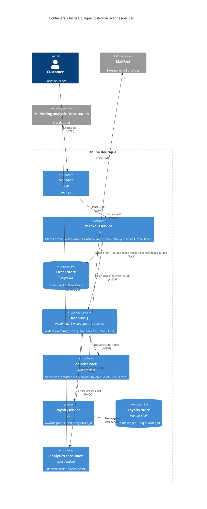

# ADR-0002: Publish an `OrderPlaced` event via a transactional outbox and RabbitMQ

- **Status:** Proposed
- **Date:** 2026-10-26
- **Deciders:** ชยพล กุลตานนท์

## Context and problem

Requirement R-12 (`docs/scenario.md`) กำหนดว่าหลังจากสั่งซื้อสำเร็จ ระบบต้อง (1) ส่งอีเมลยืนยันผ่าน **MailFast** แทน logic mock ของ `emailservice` (2) ให้ **loyalty points** ผ่าน `loyaltyservice` ตัวใหม่ และ (3) บันทึก **analytics event "order placed"** ให้ทีม marketing นอกจากนี้ marketing คาดว่า **ปีหน้าจะมี post-order action เพิ่มอีก** (SMS, fraud scoring, recommendations update)

**การทำงานในปัจจุบัน (จากโค้ด):**

| ข้อเท็จจริง | หลักฐาน |
|---|---|
| `PlaceOrder` เรียก `chargeCard` → `shipOrder` → `emptyUserCart` → `sendOrderConfirmation` ตามลำดับแบบ synchronous | `system/online-boutique/src/checkoutservice/main.go` (`PlaceOrder`, บรรทัด 230–280) |
| ถ้าการส่งอีเมลล้มเหลว จะแค่ log warning แล้ว order ยังสำเร็จ | `main.go` บรรทัด 273–277 (`log.Warnf("failed to send order confirmation ...")`) |
| การเรียก email ใช้ gRPC ผ่าน `ctx` เดียวกับ request ของ checkout จึงบล็อก response จนกว่า email จะตอบ | `main.go` (`sendOrderConfirmation`, บรรทัด 379–384) |
| `checkoutservice` มี gRPC client ตายตัวต่อ downstream แต่ละตัว ซึ่งตั้งค่าผ่าน env var | `main.go` (struct `checkoutService` บรรทัด 66–86, `EMAIL_SERVICE_ADDR` บรรทัด 115) |
| `orderID` ถูกสร้างเป็น UUID ใน `PlaceOrder` | `main.go` บรรทัด 233 (`uuid.NewUUID()`) |
| `checkoutservice` **ไม่มี** database หรือ order store | ใน `main.go` ไม่มี data store ใด ๆ (ADR นี้จึงต้องเพิ่มใหม่) |

**ข้อจำกัดและตัวเลขที่เกี่ยวข้อง (`docs/scenario.md`):**

- p95 ของ `PlaceOrder` ต้อง **≤ 500 ms** (ปัจจุบันประมาณ 300 ms) จึงเหลือ headroom ประมาณ **200 ms**
- MailFast มี p95 **1.5 s**, p99 **8 s**, fail ประมาณ **0.5 %**, rate limit **50 emails/s**
- Peak **200 orders/s** (11.11) ซึ่งมากกว่า rate limit ของ MailFast **4 เท่า** ส่วนเกินจึงเป็น **150 emails/s** หรือ backlog ประมาณ **9,000 emails ต่อนาทีของ peak**
- Loyalty points ต้องได้ **ภายใน 1 นาที** และ **exactly once**
- Order **ต้องไม่ fail** เพราะ email, loyalty หรือ analytics ล่ม
- ทีมถนัด Go/gRPC และมี 2 คนเคยใช้ **RabbitMQ** ทุกอย่างรันบน Kubernetes และองค์กรชอบ **open-source, self-hosted**

**ปัญหา:** ถ้าเรียก MailFast แบบ synchronous ใน `PlaceOrder` ค่า p95 ของ MailFast (1.5 s) ตัวเดียวก็เกินงบ 500 ms แล้ว ส่วน rate limit 50/s ก็รับ peak 200/s ไม่ได้ และทุก post-order action ใหม่จะต้องแก้ `checkoutservice` ซ้ำ ดังนั้นต้องตัดสินใจว่า **จะเชื่อม post-order actions เข้ากับ checkout อย่างไร** และ **จะส่งงานออกไปอย่างไรไม่ให้หายแม้ broker ล่ม**

### การตีความ requirement ที่ต้องตัดสินใจ

1. **"exactly once"** ตีความเป็น **ผลลัพธ์ทางธุรกิจ**: แต้มของแต่ละ order ถูกบันทึก **ครั้งเดียวพอดี ไม่หายและไม่ซ้ำ** การที่แต้มหาย (0 ครั้ง) ผิด requirement เท่ากับการได้แต้มซ้ำ (2 ครั้ง) message broker ส่งแบบ exactly-once จริงไม่ได้ จึงประกอบจาก **at-least-once delivery** (ไม่หาย) กับ **idempotent consumer** (ไม่ซ้ำ)
2. **"order must never fail"** หมายความว่า email, loyalty, analytics **และ broker ที่ใช้ส่งงานไปหาสามตัวนี้** ต้องไม่อยู่ใน critical path ของ `PlaceOrder`
3. **"ภายใน 1 นาที"** ใช้ **ตามที่ scenario เขียน คือทุก order (100 %) ไม่ใช่ p99** ในสภาวะที่ทุก component ทำงานปกติ รวมถึงช่วง peak 200 orders/s
   - ไม่เลือก p99 เพราะ scenario ไม่ได้ให้ percentile การเลือก p99 เท่ากับทีมผ่อน requirement เอง (ที่ peak 1 % คือประมาณ 2 orders/s ที่อาจช้ากว่า 1 นาที) และงบเวลาของการออกแบบนี้ในสภาวะปกติต่ำกว่า 60 s มาก จึงไม่จำเป็นต้องผ่อน
   - **ข้อยกเว้นที่ตั้งใจยอมรับ:** ถ้า RabbitMQ หรือ `loyaltyservice` ล่มนานกว่า 1 นาที ระบบจะรักษา "ภายใน 1 นาที" ไม่ได้ การรับประกันข้อนี้ในช่วงนั้นมีทางเดียวคือให้ order fail ซึ่งขัดกับ availability โดยตรง ADR นี้จึงให้ **availability และ "ไม่หาย" ชนะ "ภายใน 1 นาที"**: แต้มไม่หาย ได้รับทันทีที่ระบบกลับมา และมี alert แจ้งทีม ข้อยกเว้นนี้ต้องยืนยันกับ business (ดู Open questions)

## Decision drivers

1. **Availability:** order ต้องสำเร็จแม้ email, loyalty, analytics หรือ broker ล่ม
2. **Performance (latency):** p95 `PlaceOrder` ≤ 500 ms ที่ 200 orders/s
3. **Correctness ของ loyalty:** แต้มไม่หายและไม่ซ้ำ (exactly once ตามการตีความด้านบน) และได้ภายใน 1 นาทีในสภาวะปกติ
4. **Throughput / rate limiting:** รองรับ 200 orders/s ทั้งที่ MailFast รับได้แค่ 50 emails/s และ fail ประมาณ 0.5 %
5. **Modifiability:** เพิ่ม action ใหม่ (SMS, fraud scoring, recommendations) ได้โดยไม่ต้องแก้ `checkoutservice`
6. **Operability และทักษะทีม:** open-source, self-hosted บน Kubernetes และเหมาะกับทีม 4 คนที่ถนัด Go/gRPC และมีประสบการณ์ RabbitMQ

## Considered options

### ส่วนที่ 1: จะเชื่อม post-order actions กับ checkout อย่างไร

1. **Synchronous gRPC fan-out:** ให้ `PlaceOrder` เรียก `emailservice` (ที่เรียก MailFast), `loyaltyservice` และ analytics ต่อจากเดิม อาจเรียกแบบขนานพร้อม timeout
2. **Fire-and-forget ใน process:** `checkoutservice` สั่ง goroutine ไปเรียกแต่ละ action หลังตอบ client
3. **Publish `OrderPlaced` event ไปที่ RabbitMQ (self-hosted):** ใช้ topic exchange และให้แต่ละ consumer มี queue ของตัวเอง
4. **Publish `OrderPlaced` event ไปที่ Apache Kafka (self-hosted):** ใช้ topic ที่มีหลาย consumer group

| Option | Pros | Cons |
|---|---|---|
| 1. Sync gRPC fan-out | ทีมคุ้นเคย (Go/gRPC) ไม่มี infrastructure ใหม่ เห็นผลลัพธ์ทันที | MailFast p95 1.5 s / p99 8 s ทำให้ p95 เกิน 500 ms (ถ้าตั้ง timeout สั้น อีเมลจะหลุดบ่อย) ที่ 200 orders/s จะชน rate limit 50/s ทุก action ใหม่เพิ่ม latency และต้องแก้ `checkoutservice` ทั้ง retry และ dedup ต้องทำเองใน checkout |
| 2. Fire-and-forget goroutine | latency ของ `PlaceOrder` ไม่ขึ้นกับ MailFast และไม่มี infrastructure ใหม่ | งานหายถ้า pod restart (ไม่มี durability) จึงผิดทั้ง "ไม่หาย" และ "ภายใน 1 นาที" คุม rate limit 50/s ข้ามหลาย replica ได้ยาก retry และ dedup ต้องเขียนเอง และยังต้องแก้ `checkoutservice` ทุกครั้งที่เพิ่ม action |
| 3. RabbitMQ event | แยก checkout ออกจาก action ทั้งหมด แต่ละ queue buffer backlog ของตัวเอง (backlog email ไม่กระทบ loyalty) มี manual ack, retry และ dead-letter queue ในตัว เพิ่ม action ใหม่ได้แค่ bind queue ใหม่ เป็น open-source, self-hosted บน Kubernetes ได้ และมี 2 คนในทีมเคยใช้ | ต้อง operate cluster ที่มี state เพิ่มอีกตัว การส่งเป็น at-least-once จึงต้องทำ idempotency ฝั่ง consumer debug แบบ async ยากกว่า และอีเมลจะไปถึงช้าลงช่วง peak |
| 4. Kafka event | throughput สูงมาก เก็บ log ไว้ replay ได้ (เหมาะกับ analytics ย้อนหลัง) และเพิ่ม consumer group ใหม่ได้ง่าย | scenario ระบุประสบการณ์ทีมแค่ RabbitMQ ไม่มี Kafka operate ยากกว่า (partitions, KRaft, retention) และเกินความจำเป็นที่ 200 events/s per-message retry, delay และ DLQ สำหรับ email ไม่มีในตัว ต้องสร้างเพิ่มเอง (ทำได้ แต่เป็นงานเพิ่มสำหรับทีม 4 คน) |

### ส่วนที่ 2: จะ publish event อย่างไรไม่ให้หาย

| Option | Pros | Cons |
|---|---|---|
| A. Publish ตรงจาก `PlaceOrder` พร้อม publisher confirms ถ้าล้มเหลวให้ log แล้ว order สำเร็จ (ร่างแรก) | ง่าย ไม่ต้องมี database | ถ้า broker ล่มหรือ publish timeout **event ของ order นั้นหายถาวร** แต้มจึงหาย ผิด "exactly once" และ broker ยังอยู่ใน request path (เพิ่ม latency และ timeout) |
| B. Publish ตรง และให้ order **fail** ถ้า publish ไม่สำเร็จ | ไม่มีแต้มหาย | order fail เพราะ broker ล่ม ผิด "order must never fail" |
| C. **Order store + transactional outbox** | บันทึก order และ event ใน transaction เดียวกัน event จึงไม่หาย broker ออกจาก request path ทั้งหมด ได้ทั้ง "ไม่หาย" และ "order ไม่ fail เพราะ broker" | ต้องเพิ่ม database ให้ `checkoutservice` และ relay process database กลายเป็นส่วนหนึ่งของ critical path ของ checkout |

## Decision

เลือก **Option 3 (RabbitMQ) ร่วมกับ Option C (order store + transactional outbox)**

**1. Order store + transactional outbox ใน `checkoutservice`**

- เพิ่ม **PostgreSQL** (open-source, self-hosted บน Kubernetes เช่นผ่าน operator) เป็น order store ของ `checkoutservice`
- ในตำแหน่งที่ `PlaceOrder` เคยเรียก `sendOrderConfirmation` (`main.go` บรรทัด 273) ให้เขียน **transaction เดียว** ที่ insert ทั้งแถว `orders` และแถว `outbox` (`event_id` = `order_id`, `payload` = `OrderPlaced`, `published_at` = NULL) แล้วจึงตอบ client
- **Outbox relay** เป็น goroutine ใน `checkoutservice` ดึงแถวที่ยังไม่ publish ด้วย `SELECT ... FOR UPDATE SKIP LOCKED` (หลาย replica ทำงานพร้อมกันได้โดยไม่แย่งแถวเดียวกัน) publish ไป RabbitMQ พร้อม **publisher confirms** แล้วจึง mark `published_at`
- ถ้า relay crash หลัง publish แต่ก่อน mark แถวนั้นจะถูก publish ซ้ำ ซึ่งเป็นพฤติกรรมที่ตั้งใจ (at-least-once) และ consumer จัดการด้วย idempotency
- Polling interval ของ relay ตั้งค่าเริ่มต้นที่ **1 s** เพราะใช้งบเวลา 60 s ไปน้อยมาก และเป็นค่าที่ปรับได้หลังวัดผล แถวที่ publish แล้วถูกลบตาม retention

**2. RabbitMQ**

- Topic exchange `orders` ใช้ **quorum queues** และแยก **queue ต่อ consumer** แต่ละ queue มี dead-letter queue
- Cluster **3 nodes** เพราะ quorum queues ใช้ Raft ที่ต้องมีเสียงข้างมาก 3 nodes คือจำนวนน้อยที่สุดที่ทนได้ 1 node ล่มโดย queue ยังทำงาน (2 nodes ทนไม่ได้เลย) เมื่อมี outbox แล้ว broker ล่มจะไม่ทำให้ข้อมูลหาย 3 nodes จึงมีไว้เพื่อ **availability และงบ 1 นาที** ไม่ใช่เพื่อกันข้อมูลหาย

**3. Consumers** (ทุกตัว ack แบบ manual หลังทำงานเสร็จ)

- **`emailservice`** (เขียน logic ใหม่แทน mock) เรียก MailFast
  - คุม rate ด้วย **token bucket ในตัว worker** ไม่ใช่ prefetch เพราะ prefetch จำกัดแค่จำนวน message ที่ค้าง ack ไม่ได้จำกัดอัตรา อัตราจริงคือ in-flight ÷ latency ถ้า MailFast ตอบเร็วขึ้น อัตราจะเกิน 50/s ทันที
  - Deploy เป็น **จำนวน replica คงที่ N** (ไม่ใช้ HPA) และให้แต่ละ replica จำกัด **50/N ต่อวินาที** อัตรารวมจึงไม่เกิน 50/s
  - Prefetch ใช้กำหนด **concurrency** เท่านั้น ตาม Little's law ต้องมีงานค้างพร้อมกันประมาณ 50/s × 1.5 s ≈ **75** ที่ p95 (มากกว่านี้เมื่อ latency พุ่งถึง p99 8 s) จึงตั้ง prefetch รวมทุก replica ให้ไม่ต่ำกว่าค่านี้
  - Retry แบบ exponential backoff สำหรับ 0.5 % ที่ fail และเมื่อได้ rate-limit error จาก MailFast เกินจำนวนครั้งที่กำหนดจึงส่งเข้า DLQ
- **`loyaltyservice`** (Go/gRPC) ให้แต้มโดย **dedup ด้วย `order_id`** ผ่าน unique constraint ใน loyalty store บันทึกแต้มและ ack หลัง commit เท่านั้น message ซ้ำจะชน constraint แล้ว ack ทิ้ง ผลคือแต้มได้ครั้งเดียว
  - งบ 1 นาที: relay poll ≤ 1 s + publish หลักมิลลิวินาที + รอใน queue + ประมวลผล queue ของ loyalty แยกจาก email จึงไม่ติด backlog ของ MailFast throughput ของ consumer ต้องมากกว่า 200/s ที่ peak และ scale ด้วย HPA ตามความยาว queue
- **analytics consumer** บันทึก event "order placed" ไปยังปลายทางของ marketing (ปลายทางยังไม่ระบุ ดู Open questions)
- Action ในอนาคต (SMS, recommendations) ทำเป็น consumer ใหม่ที่ bind queue ของตัวเองเข้ากับ exchange เดิม โดย **ไม่ต้องแก้ `checkoutservice`**

**4. Monitoring** (ค่า threshold เป็นค่าเริ่มต้นที่ปรับหลังวัดผล)

- Alert เมื่อ **message ที่เก่าที่สุดใน queue ของ loyalty อายุเกิน 30 s** และเมื่อ **แถวที่เก่าที่สุดที่ยังไม่ publish ใน outbox อายุเกิน 30 s** ใช้ครึ่งหนึ่งของงบ 60 s เป็นสัญญาณเตือนล่วงหน้าว่า SLO เสี่ยง (เช่น broker หรือ relay มีปัญหา) ก่อนจะละเมิดจริง
- Alert เมื่อ DLQ ใดไม่ว่าง

**เหตุผล:** RabbitMQ เป็น option เดียวในส่วนที่ 1 ที่ผ่าน driver 1–5 พร้อมกัน และตรงกับประสบการณ์ทีมกับข้อกำหนด self-hosted (driver 6) มากกว่า Kafka ส่วน outbox เป็น option เดียวในส่วนที่ 2 ที่ทำให้ได้ทั้ง "แต้มไม่หาย" และ "order ไม่ fail เพราะ broker" พร้อมกัน

> หมายเหตุ: protocol ระหว่าง `emailservice` กับ MailFast (HTTPS) เป็น **[Inferred]** เพราะ scenario ไม่ระบุ API ของ MailFast

## Consequences

- **Positive:** latency ของ MailFast (p95 1.5 s / p99 8 s) และ RabbitMQ ไม่อยู่ใน `PlaceOrder` อีกต่อไป สิ่งที่เพิ่มใน request path มีเพียง transaction เดียวกับ PostgreSQL ขณะที่ gRPC call ไป `emailservice` ถูกตัดออก จึงคาดว่า p95 ยังอยู่ใน headroom 200 ms **[Inferred ต้องวัด]** (quality attribute: **performance**)
- **Positive:** ถ้า email, loyalty, analytics หรือ RabbitMQ ทั้ง cluster ล่ม order ยังสำเร็จ event สะสมใน outbox หรือ queue แล้วถูกประมวลผลเมื่อระบบกลับมา โดยไม่มีอะไรหาย (quality attribute: **availability, reliability**)
- **Positive:** แต้มไม่หาย (outbox + at-least-once) และไม่ซ้ำ (dedup ด้วย `order_id`) (quality attribute: **correctness**)
- **Positive:** backlog ช่วง 11.11 (ประมาณ 9,000 emails ต่อนาทีของ peak) ถูก buffer ใน queue และถูกส่งที่ ≤ 50/s โดยไม่ชน rate limit (quality attribute: **scalability / throughput**)
- **Positive:** เพิ่ม SMS หรือ recommendations ได้ด้วยการเพิ่ม consumer ใหม่ โดย `checkoutservice` ไม่ต้องรู้จัก service ใหม่ (quality attribute: **modifiability**)
- **Negative:** มี stateful component ใหม่ **สองตัว** (PostgreSQL และ RabbitMQ cluster) ที่ต้อง deploy, monitor, upgrade และ backup สำหรับทีม 4 คน (quality attribute: **operability / cost**)
- **Negative:** PostgreSQL กลายเป็นส่วนหนึ่งของ critical path ถ้า order store ล่ม checkout จะ fail ข้อนี้ไม่ขัดกับ scenario เพราะ availability constraint ครอบคลุมแค่ email, loyalty และ analytics ส่วน order store เป็น state หลักของ checkout เอง แต่ต้องทำ HA ให้ PostgreSQL (quality attribute: **availability**)
- **Negative:** อีเมลยืนยันจะไปถึงช้าลงในช่วง peak เช่น peak 10 นาทีจะมี backlog ประมาณ 90,000 emails ซึ่งต้องใช้เวลาระบายอย่างน้อย 30 นาทีที่ 50/s (ตัวเลข 10 นาทีเป็นตัวอย่างการคำนวณเท่านั้น ไม่ใช่ข้อเท็จจริง) (quality attribute: **performance (end-to-end latency) / usability**)
- **Negative:** ระบบกลายเป็น eventually consistent และ debug ยากขึ้น ต้อง propagate trace context ผ่าน outbox payload และ message header (checkout ใช้ OpenTelemetry อยู่แล้ว ดู `main.go` บรรทัด 134–140) (quality attribute: **testability / observability**)
- **Risks and mitigations:**
  - **Broker หรือ relay ล่มนานกว่า 1 นาที** → แต้มไม่หายแต่ช้ากว่า 1 นาที (ข้อยกเว้นที่ยอมรับใน Context) mitigation: RabbitMQ 3 nodes, relay อยู่ในทุก replica ของ checkout และ alert อายุ outbox เกิน 30 s
  - **Duplicate delivery** (relay publish ซ้ำ หรือ broker redeliver) → consumer ทุกตัวต้อง idempotent โดยใช้ `order_id` เป็น key
  - **Loyalty ช้ากว่า 1 นาทีในสภาวะปกติ** เพราะ consumer มีไม่พอ → queue แยกจาก email, HPA ตามความยาว queue และ alert อายุ message เกิน 30 s
  - **ตัดเงินสำเร็จแต่เขียน order store ไม่สำเร็จ** → ลูกค้าถูกตัดเงินแต่ order fail ปัญหาประเภทเดียวกันมีอยู่แล้วในโค้ดปัจจุบัน (ตัดเงินแล้ว `shipOrder` fail) และอยู่นอกขอบเขต R-12 บันทึกไว้ใน Open questions
  - **Poison message / MailFast fail ซ้ำ** → retry แบบ backoff, DLQ และ alert เมื่อ DLQ ไม่ว่าง
  - **PII (email address) อยู่ใน outbox และ broker** → จำกัดสิทธิ์เข้าถึง, ลบแถว outbox ที่ publish แล้วตาม retention และส่งเฉพาะข้อมูลที่จำเป็นให้ analytics

## Validation

- **Load test** ด้วย Locust `loadgenerator` ที่ **200 orders/s** โดยตรวจว่า p95 `PlaceOrder` ≤ 500 ms และไม่มี order fail
- **Fault injection:** ปิด `emailservice`, `loyaltyservice`, analytics consumer, MailFast (ใช้ stub) และ **RabbitMQ ทั้ง cluster** ระหว่าง load test แล้วยืนยันว่า order ยังสำเร็จ 100 % และเมื่อระบบกลับมา จำนวนแต้มที่ให้ = จำนวน order ไม่ซ้ำ (ไม่มีแต้มหาย)
- **Duplicate test:** kill relay หลัง publish แต่ก่อน mark และ kill consumer ก่อน ack แล้วยืนยันว่าไม่มีแต้มซ้ำ
- **Loyalty SLO:** ในสภาวะปกติที่ 200 orders/s วัดเวลาตั้งแต่ commit order จนให้แต้มเสร็จ ต้อง **ทุก order (ค่า max) ≤ 60 s** ไม่ใช่ p99
- **MailFast rate:** ตรวจว่าอัตราเรียก MailFast รวมทุก replica ไม่เกิน 50/s และไม่มี rate-limit error ทั้งตอน stub ตอบเร็วและตอบช้า
- **Modifiability check:** ทดลองเพิ่ม consumer จำลอง (เช่น SMS stub) โดยไม่ deploy `checkoutservice` ใหม่
- ทบทวน ADR นี้หลัง 11.11 ครั้งถัดไป หรือเมื่อเพิ่ม post-order action ตัวแรกของปีหน้า

## Open questions

- **Business ยอมรับข้อยกเว้นได้หรือไม่** ว่าในช่วงที่ RabbitMQ หรือ `loyaltyservice` ล่ม แต้มจะได้ช้ากว่า 1 นาที (แต่ไม่หาย)
- **ระยะเวลาของ peak 11.11** ยาวเท่าไร และ **อีเมลยืนยันช้าได้มากที่สุดเท่าไร** ใช้กำหนดขนาด backlog และตัดสินว่าต้องขอเพิ่ม rate limit กับ MailFast หรือไม่
- **Rate limit 50/s ของ MailFast** นับต่อ account, ต่อ API key หรือต่อ IP และตอบอะไรเมื่อเกิน MailFast มี idempotency key ให้กันอีเมลซ้ำเมื่อ retry หรือไม่ ควรตั้งเพดานต่ำกว่า 50/s เผื่อไว้หรือไม่
- **Latency ของ transaction เขียน order + outbox** บน PostgreSQL จริงเป็นเท่าไร ต้องวัด
- **ทีมมีประสบการณ์ PostgreSQL หรือไม่** (scenario ไม่ระบุ) และมีเวลาและงบสำหรับ operate PostgreSQL กับ RabbitMQ หรือไม่
- **กรณีตัดเงินแล้วเขียน order ไม่สำเร็จ** จะคืนเงินหรือ compensate อย่างไร (ปัญหาเดิมของ checkout อยู่นอกขอบเขต ADR นี้)
- **ปลายทางของ analytics** สำหรับทีม marketing คืออะไร และต้องการ replay ข้อมูลย้อนหลังหรือไม่ (ถ้าต้องการ Kafka อาจคุ้มกว่า)
- **Store ของ `loyaltyservice`** จะใช้อะไร (ต้องรองรับ unique constraint บน `order_id`) และ **ภาษาที่ใช้เขียน `emailservice` ใหม่**
- **Fraud scoring** ในอนาคตอาจต้อง **บล็อก order ก่อนยืนยัน** ซึ่งเป็น synchronous ไม่ใช่ post-order event จึงไม่ครอบคลุมด้วย ADR นี้ ต้องยืนยันกับ marketing
