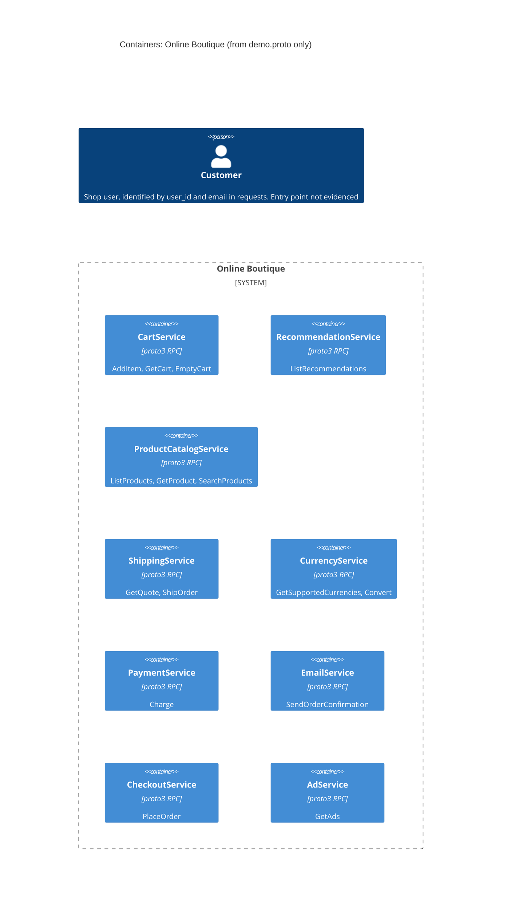

# Task 1 · Run A: Recovered C4 container architecture

## 1. Agent

- Product: Claude Code (VS Code extension)
- Model: Claude Opus 5.5 (`claude-opus-5-5`)

## 2. Files read

- `prompts/1-recover-architecture.md` (task instructions)
- `system/online-boutique/protos/demo.proto` (the only evidence file)

## 3. Containers table

The evidence is one Protocol Buffers interface file. It defines **9 RPC services** in `package hipstershop` (line 17). It does **not** say how services are deployed, which language each one uses, or which data stores exist.

| Container | Technology / language | Responsibility (from RPC methods) | Evidence |
|---|---|---|---|
| CartService | proto3 RPC interface; language not evidenced | Adds items to, reads and empties a user's cart (`AddItem`, `GetCart`, `EmptyCart`) | `system/online-boutique/protos/demo.proto` L23–27 (`service CartService`) |
| RecommendationService | proto3 RPC interface; language not evidenced | Returns recommended product IDs for a user and a list of products (`ListRecommendations`) | `demo.proto` L56–58 (`service RecommendationService`) |
| ProductCatalogService | proto3 RPC interface; language not evidenced | Lists, gets and searches products (`ListProducts`, `GetProduct`, `SearchProducts`) | `demo.proto` L71–75 (`service ProductCatalogService`) |
| ShippingService | proto3 RPC interface; language not evidenced | Quotes shipping cost and ships orders, returning a tracking ID (`GetQuote`, `ShipOrder`) | `demo.proto` L107–110 (`service ShippingService`) |
| CurrencyService | proto3 RPC interface; language not evidenced | Lists supported currencies and converts `Money` between ISO 4217 codes (`GetSupportedCurrencies`, `Convert`) | `demo.proto` L140–143 (`service CurrencyService`) |
| PaymentService | proto3 RPC interface; language not evidenced | Charges a credit card for an amount and returns a transaction ID (`Charge`) | `demo.proto` L177–179 (`service PaymentService`) |
| EmailService | proto3 RPC interface; language not evidenced | Sends an order confirmation to an email address (`SendOrderConfirmation`) | `demo.proto` L199–201 (`service EmailService`) |
| CheckoutService | proto3 RPC interface; language not evidenced | Places an order for a user and returns an `OrderResult` (`PlaceOrder`) | `demo.proto` L224–226 (`service CheckoutService`) |
| AdService | proto3 RPC interface; language not evidenced | Returns text ads for a set of page context keywords (`GetAds`) | `demo.proto` L243–245 (`service AdService`) |

Notes:
- Protocol: the file uses proto3 `service` / `rpc` definitions (L15, L23 ff.). Using gRPC as the transport is **[Inferred]**: it is the usual runtime for these definitions, but the file never says "gRPC".
- `option go_package` (L19) shows that Go stubs are generated from this file. It does not show which language any service is written in.
- **Data stores:** none evidenced. No `ContainerDb` is included.
- **End user:** the `Person` in the diagram is supported only by `user_id` / `email` fields (e.g. `GetCartRequest.user_id` L44, `PlaceOrderRequest.user_id`/`email` L229, L233). No user-facing container (web UI or API gateway) is defined in the file.

## 4. Dependencies table

A `.proto` file defines what each service **offers**. It does not show who **calls** whom, so no runtime dependency is evidenced.

| Caller → callee | Protocol | Evidence |
|---|---|---|
| *None evidenced* | — | `demo.proto` contains only service and message definitions. It has no client configuration, addresses or call sites. |

Candidate dependencies inferred from shared message types are listed under **Gaps** and are **not** in the diagram.

## 5. Mermaid diagram

The diagram matches the tables: 9 containers, no data stores, and no `Rel` lines, because no dependency is evidenced.

## 6. Gaps

| Gap | Why it can't be settled from `demo.proto` | File(s) that would settle it |
|---|---|---|
| Runtime dependencies (who calls whom) | A proto declares interfaces, not clients | Kubernetes manifests with `*_SERVICE_ADDR` env vars, e.g. `system/online-boutique/kubernetes-manifests/frontend.yaml` (named in `AGENTS.md`); the services' source code |
| User-facing entry point (web frontend / gateway) and its protocol (e.g. HTTP) | No such service is defined. `AdRequest.context_keys` ("key words from the current page", L248) suggests a page-rendering client exists **[Inferred]** | `system/online-boutique/kubernetes-manifests/` (frontend Deployment/Service) |
| Transport protocol | Only proto3 `service`/`rpc` syntax; gRPC is **[Inferred]** | Service source code (gRPC server setup) or manifests (ports / gRPC health probes) |
| Implementation language per service | `go_package` (L19) covers generated stubs only | Each service's source folder / Dockerfile |
| Data stores (e.g. where the cart is kept) | The `Cart` message (L47–50) needs state somewhere, but no store is shown | Cart service source and its manifest (e.g. a database/cache Deployment and connection env var) |
| External systems (real payment provider, email/SMTP, ad network) | `PaymentService.Charge` and `EmailService.SendOrderConfirmation` may be mocks or may call externals. Not evidenced | Payment and email service source code |
| Deployment units and names | Proto service names may differ from container/Deployment names | `system/online-boutique/kubernetes-manifests/` |

**Candidate dependencies (all [Inferred] from shared message types, not in the diagram):**

| Candidate caller → callee | Reasoning from `demo.proto` |
|---|---|
| CheckoutService → CartService | `PlaceOrderRequest.user_id` (L229) is the key for `GetCart`/`EmptyCart` |
| CheckoutService → ProductCatalogService | `OrderItem.cost` (L205) needs a product price (`Product.price_usd`, L82) |
| CheckoutService → CurrencyService | `PlaceOrderRequest.user_currency` (L230) matches `Convert` |
| CheckoutService → ShippingService | `OrderResult.shipping_tracking_id` / `shipping_cost` (L210–211) match `ShipOrder` / `GetQuote` responses |
| CheckoutService → PaymentService | `PlaceOrderRequest.credit_card` (L234) is the `ChargeRequest.credit_card` type |
| CheckoutService → EmailService | `PlaceOrderRequest.email` + `OrderResult` (L233, L238) match `SendOrderConfirmationRequest` |
| RecommendationService → ProductCatalogService | Returns product IDs, so it needs a set of known products to choose from |
| Customer → (unknown frontend) → CartService, ProductCatalogService, RecommendationService, CurrencyService, ShippingService, CheckoutService, AdService | User-scoped and page-context requests; no frontend container is evidenced |
