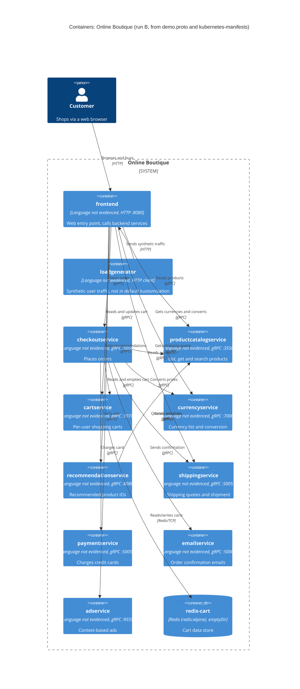

# 1B — Recovered architecture (run B)

## 1. Agent

Claude Code (Anthropic), model **Claude Opus 5.5** (`claude-opus-5-5`).

## 2. Files read

Task instructions: `prompts/1-recover-architecture.md` (plus `AGENTS.md` / `CLAUDE.md`, loaded as repository rules).

Evidence:

- `system/online-boutique/protos/demo.proto`
- `system/online-boutique/kubernetes-manifests/README.md`
- `system/online-boutique/kubernetes-manifests/kustomization.yaml`
- `system/online-boutique/kubernetes-manifests/adservice.yaml`
- `system/online-boutique/kubernetes-manifests/cartservice.yaml`
- `system/online-boutique/kubernetes-manifests/checkoutservice.yaml`
- `system/online-boutique/kubernetes-manifests/currencyservice.yaml`
- `system/online-boutique/kubernetes-manifests/emailservice.yaml`
- `system/online-boutique/kubernetes-manifests/frontend.yaml`
- `system/online-boutique/kubernetes-manifests/loadgenerator.yaml`
- `system/online-boutique/kubernetes-manifests/paymentservice.yaml`
- `system/online-boutique/kubernetes-manifests/productcatalogservice.yaml`
- `system/online-boutique/kubernetes-manifests/recommendationservice.yaml`
- `system/online-boutique/kubernetes-manifests/shippingservice.yaml`

Paths below are relative to `system/online-boutique/`.

## 3. Containers table

Implementation language is **Not evidenced in the provided files** for any service. The manifests only give image names (e.g. `image: frontend`), not a language or base image. The technology column therefore lists only what the evidence shows: the exposed protocol and port.

| Container | Technology / language | Responsibility | Evidence |
|---|---|---|---|
| `frontend` | Language not evidenced; HTTP server on :8080, exposed via `LoadBalancer` Service `frontend-external` :80 | Web entry point for shoppers. Calls the backend services listed in its `*_SERVICE_ADDR` env vars | `kubernetes-manifests/frontend.yaml` (Deployment `frontend`, `httpGet /_healthz` probe, Services `frontend` and `frontend-external`) |
| `productcatalogservice` | Language not evidenced; gRPC server :3550 | Lists, gets and searches products (`ListProducts`, `GetProduct`, `SearchProducts`) | `protos/demo.proto` (`service ProductCatalogService`, L71–75); `kubernetes-manifests/productcatalogservice.yaml` (port name `grpc`, grpc probes) |
| `cartservice` | Language not evidenced; gRPC server :7070 | Stores per-user shopping carts (`AddItem`, `GetCart`, `EmptyCart`) | `protos/demo.proto` (`service CartService`, L23–27); `kubernetes-manifests/cartservice.yaml` (Deployment `cartservice`) |
| `redis-cart` | Redis (`redis:alpine` image), TCP :6379, `emptyDir` volume at `/data` | Data store behind `cartservice`. Storage is pod-scoped (`emptyDir`), so it is not durable across pod rescheduling | `kubernetes-manifests/cartservice.yaml` (Deployment/Service `redis-cart`, L89–156) |
| `currencyservice` | Language not evidenced; gRPC server :7000 | Lists supported currencies and converts `Money` amounts (`GetSupportedCurrencies`, `Convert`) | `protos/demo.proto` (`service CurrencyService`, L140–143); `kubernetes-manifests/currencyservice.yaml` |
| `recommendationservice` | Language not evidenced; gRPC server :8080 | Returns recommended product IDs (`ListRecommendations`) | `protos/demo.proto` (`service RecommendationService`, L56–58); `kubernetes-manifests/recommendationservice.yaml` |
| `shippingservice` | Language not evidenced; gRPC server :50051 | Quotes shipping cost and ships orders (`GetQuote`, `ShipOrder`) | `protos/demo.proto` (`service ShippingService`, L107–110); `kubernetes-manifests/shippingservice.yaml` |
| `checkoutservice` | Language not evidenced; gRPC server :5050 | Places orders (`PlaceOrder`), coordinating cart, catalog, currency, shipping, payment and email | `protos/demo.proto` (`service CheckoutService`, L224–226); `kubernetes-manifests/checkoutservice.yaml` (six `*_SERVICE_ADDR` env vars) |
| `paymentservice` | Language not evidenced; gRPC server :50051 | Charges a credit card and returns a transaction ID (`Charge`) | `protos/demo.proto` (`service PaymentService`, L177–179); `kubernetes-manifests/paymentservice.yaml` |
| `emailservice` | Language not evidenced; gRPC server: Service :5000 → container :8080 | Sends order confirmation (`SendOrderConfirmation`) | `protos/demo.proto` (`service EmailService`, L199–201); `kubernetes-manifests/emailservice.yaml` (Service port 5000, `targetPort: 8080`) |
| `adservice` | Language not evidenced; gRPC server :9555 | Returns ads for context keywords (`GetAds`) | `protos/demo.proto` (`service AdService`, L243–245); `kubernetes-manifests/adservice.yaml` |
| `loadgenerator` | Language not evidenced; HTTP client (no Service, no ports) | Generates synthetic user traffic (`USERS=10`, `RATE=1`) against `frontend`. **Not part of the default deployment**: commented out in `kustomization.yaml` L24 | `kubernetes-manifests/loadgenerator.yaml` (Deployment `loadgenerator`); `kubernetes-manifests/kustomization.yaml` L24 |

## 4. Dependencies table

How the protocol is determined: for gRPC edges, the **callee's** Service port is named `grpc`, it has `grpc:` readiness/liveness probes, and it has a matching `service` in `demo.proto`. The caller-side evidence is the address env var. Which specific RPCs each caller invokes is **Not evidenced in the provided files** (see Gaps).

| Caller → Callee | Protocol | Evidence |
|---|---|---|
| Customer → `frontend` | HTTP | `kubernetes-manifests/frontend.yaml` (Service `frontend-external`, `type: LoadBalancer`, port name `http`, 80 → 8080) |
| `loadgenerator` → `frontend` | HTTP | `kubernetes-manifests/loadgenerator.yaml` (`FRONTEND_ADDR=frontend:80`; init container `wget http://${FRONTEND_ADDR}`) |
| `frontend` → `productcatalogservice` | gRPC | `kubernetes-manifests/frontend.yaml` (`PRODUCT_CATALOG_SERVICE_ADDR=productcatalogservice:3550`) |
| `frontend` → `currencyservice` | gRPC | `kubernetes-manifests/frontend.yaml` (`CURRENCY_SERVICE_ADDR=currencyservice:7000`) |
| `frontend` → `cartservice` | gRPC | `kubernetes-manifests/frontend.yaml` (`CART_SERVICE_ADDR=cartservice:7070`) |
| `frontend` → `recommendationservice` | gRPC | `kubernetes-manifests/frontend.yaml` (`RECOMMENDATION_SERVICE_ADDR=recommendationservice:8080`) |
| `frontend` → `shippingservice` | gRPC | `kubernetes-manifests/frontend.yaml` (`SHIPPING_SERVICE_ADDR=shippingservice:50051`) |
| `frontend` → `checkoutservice` | gRPC | `kubernetes-manifests/frontend.yaml` (`CHECKOUT_SERVICE_ADDR=checkoutservice:5050`) |
| `frontend` → `adservice` | gRPC | `kubernetes-manifests/frontend.yaml` (`AD_SERVICE_ADDR=adservice:9555`) |
| `checkoutservice` → `productcatalogservice` | gRPC | `kubernetes-manifests/checkoutservice.yaml` (`PRODUCT_CATALOG_SERVICE_ADDR=productcatalogservice:3550`) |
| `checkoutservice` → `shippingservice` | gRPC | `kubernetes-manifests/checkoutservice.yaml` (`SHIPPING_SERVICE_ADDR=shippingservice:50051`) |
| `checkoutservice` → `paymentservice` | gRPC | `kubernetes-manifests/checkoutservice.yaml` (`PAYMENT_SERVICE_ADDR=paymentservice:50051`) |
| `checkoutservice` → `emailservice` | gRPC | `kubernetes-manifests/checkoutservice.yaml` (`EMAIL_SERVICE_ADDR=emailservice:5000`) |
| `checkoutservice` → `currencyservice` | gRPC | `kubernetes-manifests/checkoutservice.yaml` (`CURRENCY_SERVICE_ADDR=currencyservice:7000`) |
| `checkoutservice` → `cartservice` | gRPC | `kubernetes-manifests/checkoutservice.yaml` (`CART_SERVICE_ADDR=cartservice:7070`) |
| `recommendationservice` → `productcatalogservice` | gRPC | `kubernetes-manifests/recommendationservice.yaml` (`PRODUCT_CATALOG_SERVICE_ADDR=productcatalogservice:3550`) |
| `cartservice` → `redis-cart` | Redis protocol over TCP | `kubernetes-manifests/cartservice.yaml` (`REDIS_ADDR=redis-cart:6379`; Service `redis-cart` port name `tcp-redis`) |

## 5. Mermaid diagram

The Rel labels (e.g. "Reads products") come from the callee's RPC names in `demo.proto`. The specific RPCs each caller uses are **[Inferred]**. Only the edge and its protocol are evidenced.

## 6. Gaps

| Gap | Why it is unresolved | File that would settle it |
|---|---|---|
| Implementation language and framework of every service | Manifests reference images by name only (`image: frontend`, …) | Each service's `src/<service>/Dockerfile` (and source tree) |
| Which RPCs each caller invokes (e.g. does `frontend` call `CartService.EmptyCart`?) | `demo.proto` defines services but not their callers. Manifests only give addresses | Client code in `src/frontend/`, `src/checkoutservice/`, `src/recommendationservice/` |
| Whether `frontend` → `checkoutservice` is the only order path, and whether `checkoutservice` calls `currencyservice` per item | Not evidenced | `src/checkoutservice/` (PlaceOrder implementation) |
| `shoppingassistantservice` | `frontend.yaml` sets `SHOPPING_ASSISTANT_SERVICE_ADDR=shoppingassistantservice:80`, but no Deployment/Service for it exists in the evidence, and `ENABLE_ASSISTANT` is commented out. Not added to the diagram | `kustomize/components/shopping-assistant/` |
| Packaging service | Only a commented-out `PACKAGING_SERVICE_URL` in `frontend.yaml` | `src/frontend/` and any packaging-service docs |
| External systems: real payment gateway, SMTP/email provider, currency-rate source, ad source | No external hosts, secrets or egress config in the manifests. `PaymentService.Charge` takes `CreditCardInfo` but nothing shows it reaching an outside provider | `src/paymentservice/`, `src/emailservice/`, `src/currencyservice/`, `src/adservice/` |
| Data source of `productcatalogservice` (embedded file vs. database) | No DB address or volume in `productcatalogservice.yaml` | `src/productcatalogservice/` |
| Alternative data stores (Memorystore, AlloyDB, Spanner) and observability (Google Cloud Operations) | Only listed as commented-out components in `kustomization.yaml` L29–39 | `kustomize/components/memorystore/`, `alloydb/`, `spanner/`, `google-cloud-operations/` |
| Network restrictions between services | `network-policies` component is commented out in `kustomization.yaml` | `kustomize/components/network-policies/` |
| Whether TLS or a service mesh is used for gRPC | Only an Istio annotation (`sidecar.istio.io/rewriteAppHTTPProbers`) on `frontend` and `loadgenerator`. No mesh config in the evidence | `istio-manifests/` or mesh docs |
| Exact image tags / versions actually deployed | `kubernetes-manifests/README.md` says images are filled in by `skaffold`, and points to `/release` | `release/kubernetes-manifests.yaml`, `skaffold.yaml` |
