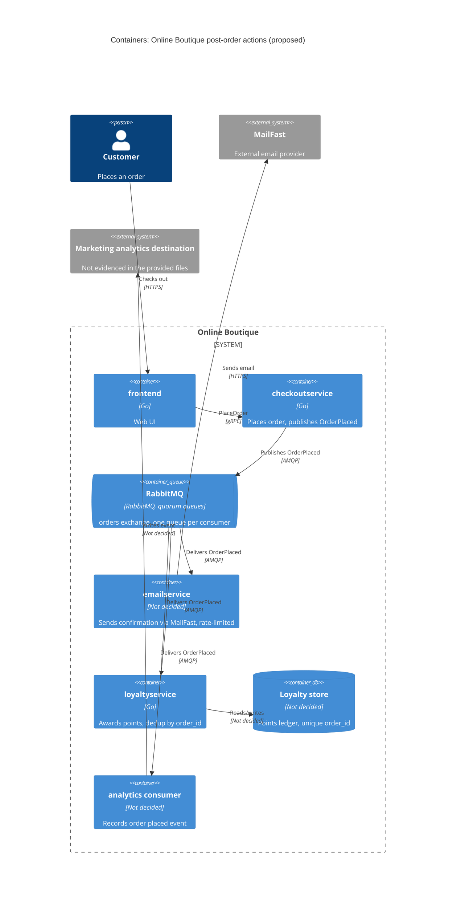

> Agent: Claude Code (Anthropic) · Model: Claude Opus 5.5 (`claude-opus-5-5`) · Task 2, run b (with context) · language: Thai

# ADR-0002: Publish an `OrderPlaced` event to RabbitMQ for post-order actions

- **Status:** Proposed
- **Date:** 2026-10-26
- **Deciders:** ทีมพัฒนา Online Boutique (นักพัฒนา 4 คน ตาม `docs/scenario.md`) ส่วนผู้อนุมัติขั้นสุดท้ายยังไม่ระบุ (ดู Open questions)

## Context and problem

Requirement R-12 (`docs/scenario.md`) กำหนดว่าหลังจากสั่งซื้อสำเร็จ ระบบต้อง (1) ส่งอีเมลยืนยันผ่าน **MailFast** แทน logic mock ของ `emailservice` (2) ให้ **loyalty points** ผ่าน `loyaltyservice` ตัวใหม่ และ (3) บันทึก **analytics event "order placed"** ให้ทีม marketing นอกจากนี้ marketing คาดว่า **ปีหน้าจะมี post-order action เพิ่มอีก** (SMS, fraud scoring, recommendations update)

**การทำงานในปัจจุบัน (จากโค้ด):**

| ข้อเท็จจริง | หลักฐาน |
|---|---|
| `PlaceOrder` เรียก `chargeCard` → `shipOrder` → `emptyUserCart` → `sendOrderConfirmation` ตามลำดับแบบ synchronous | `system/online-boutique/src/checkoutservice/main.go` (`PlaceOrder`, บรรทัด 230–280) |
| ถ้าการส่งอีเมลล้มเหลว จะแค่ log warning แล้ว order ยังสำเร็จ | `main.go` บรรทัด 273–277 (`log.Warnf("failed to send order confirmation ...")`) |
| การเรียก email ใช้ gRPC ผ่าน `ctx` เดียวกับ request ของ checkout จึงบล็อก response จนกว่า email จะตอบ | `main.go` (`sendOrderConfirmation`, บรรทัด 379–384) |
| `checkoutservice` มี gRPC client ตายตัวต่อ downstream แต่ละตัว ซึ่งตั้งค่าผ่าน env var | `main.go` (struct `checkoutService` บรรทัด 66–86, `EMAIL_SERVICE_ADDR` บรรทัด 115) |
| `orderID` ถูกสร้างเป็น UUID ใน `PlaceOrder` | `main.go` บรรทัด 233 (`uuid.NewUUID()`) |
| `checkoutservice` บันทึก order ลง database | Not evidenced in the provided files (ใน `main.go` ไม่มี data store ใด ๆ) |

**ข้อจำกัดและตัวเลขที่เกี่ยวข้อง (`docs/scenario.md`):**

- p95 ของ `PlaceOrder` ต้อง **≤ 500 ms** (ปัจจุบันประมาณ 300 ms) จึงเหลือ headroom ประมาณ **200 ms**
- MailFast มี p95 **1.5 s**, p99 **8 s**, fail ประมาณ **0.5 %**, rate limit **50 emails/s**
- Peak **200 orders/s** (11.11) ซึ่งมากกว่า rate limit ของ MailFast **4 เท่า** ส่วนเกินจึงเป็น **150 emails/s** หรือ backlog ประมาณ **9,000 emails ต่อนาทีของ peak**
- Loyalty points ต้องได้ **ภายใน 1 นาที** และ **exactly once**
- Order **ต้องไม่ fail** เพราะ email, loyalty หรือ analytics ล่ม
- ทีมถนัด Go/gRPC และมี 2 คนเคยใช้ **RabbitMQ** ทุกอย่างรันบน Kubernetes และองค์กรชอบ **open-source, self-hosted**

**ปัญหา:** ถ้าเรียก MailFast แบบ synchronous ใน `PlaceOrder` ค่า p95 ของ MailFast (1.5 s) ตัวเดียวก็เกินงบ 500 ms แล้ว ส่วน rate limit 50/s ก็รับ peak 200/s ไม่ได้ และทุก post-order action ใหม่จะต้องแก้ `checkoutservice` ซ้ำ ดังนั้นต้องตัดสินใจว่า **จะเชื่อม post-order actions เข้ากับ checkout อย่างไร**

## Decision drivers

1. **Availability:** order ต้องสำเร็จแม้ email, loyalty หรือ analytics ล่ม
2. **Performance (latency):** p95 `PlaceOrder` ≤ 500 ms ที่ 200 orders/s
3. **Correctness ของ loyalty:** ให้แต้มภายใน 1 นาที และ exactly once (ไม่ให้แต้มซ้ำ)
4. **Throughput / rate limiting:** รองรับ 200 orders/s ทั้งที่ MailFast รับได้แค่ 50 emails/s และ fail ประมาณ 0.5 %
5. **Modifiability:** เพิ่ม action ใหม่ (SMS, fraud scoring, recommendations) ได้โดยไม่ต้องแก้ `checkoutservice`
6. **Operability และทักษะทีม:** open-source, self-hosted บน Kubernetes และเหมาะกับทีม 4 คนที่ถนัด Go/gRPC และมีประสบการณ์ RabbitMQ

## Considered options

1. **Synchronous gRPC fan-out:** ให้ `PlaceOrder` เรียก `emailservice` (ที่เรียก MailFast), `loyaltyservice` และ analytics ต่อจากเดิม อาจเรียกแบบขนานพร้อม timeout
2. **Fire-and-forget ใน process:** `checkoutservice` สั่ง goroutine ไปเรียกแต่ละ action หลังตอบ client
3. **Publish `OrderPlaced` event ไปที่ RabbitMQ (self-hosted):** ใช้ topic exchange และให้แต่ละ consumer มี queue ของตัวเอง
4. **Publish `OrderPlaced` event ไปที่ Apache Kafka (self-hosted):** ใช้ topic ที่มีหลาย consumer group

### Pros and cons of the options

| Option | Pros | Cons |
|---|---|---|
| 1. Sync gRPC fan-out | ทีมคุ้นเคย (Go/gRPC) ไม่มี infrastructure ใหม่ เห็นผลลัพธ์ทันที | MailFast p95 1.5 s / p99 8 s ทำให้ p95 เกิน 500 ms (ถ้าตั้ง timeout สั้น อีเมลจะหลุดบ่อย) ที่ 200 orders/s จะชน rate limit 50/s ทุก action ใหม่เพิ่ม latency และต้องแก้ `checkoutservice` ทั้ง retry และ exactly-once ต้องทำเองใน checkout |
| 2. Fire-and-forget goroutine | latency ของ `PlaceOrder` ไม่ขึ้นกับ MailFast และไม่มี infrastructure ใหม่ | งานหายถ้า pod restart (ไม่มี durability) จึงรับประกัน loyalty ภายใน 1 นาทีไม่ได้ คุม rate limit 50/s ข้ามหลาย replica ได้ยาก retry และ dedup ต้องเขียนเอง และยังต้องแก้ `checkoutservice` ทุกครั้งที่เพิ่ม action |
| 3. RabbitMQ event | แยก checkout ออกจาก action ทั้งหมด (availability) แต่ละ queue buffer backlog email ได้โดยไม่กระทบ loyalty มี manual ack, retry และ dead-letter queue ในตัว เพิ่ม action ใหม่ได้แค่ bind queue ใหม่ (modifiability) เป็น open-source และ self-hosted บน Kubernetes ได้ และมี 2 คนในทีมเคยใช้ | ต้อง operate cluster ที่มี state เพิ่มอีกตัว broker กลายเป็น dependency ใหม่ของ checkout การส่งเป็น at-least-once จึงต้องทำ idempotency ฝั่ง consumer เอง debug แบบ async ยากกว่า และอีเมลจะไปถึงช้าลงช่วง peak |
| 4. Kafka event | throughput สูงมาก เก็บ log ไว้ replay ได้ (เหมาะกับ analytics ย้อนหลัง) และเพิ่ม consumer group ใหม่ได้ง่าย | ไม่มีหลักฐานว่าทีมมีประสบการณ์ Kafka (scenario ระบุแค่ RabbitMQ) operate ยากกว่า (partitions, KRaft, retention) และเกินความจำเป็นที่ 200 events/s ส่วน per-message retry และ DLQ ต้องสร้างเอง ซึ่งขัดกับเงื่อนไขส่ง email ที่ต้องทำ throttling และ retry ทีละ message |

## Decision

เลือก **Option 3: publish `OrderPlaced` event ไปที่ RabbitMQ (self-hosted บน Kubernetes)**

- `PlaceOrder` แทนที่การเรียก `sendOrderConfirmation` (`main.go` บรรทัด 273) ด้วยการ publish event `OrderPlaced` ครั้งเดียว ไปที่ topic exchange (เช่น `orders`) โดยเปิด **publisher confirms** และตั้ง timeout สั้น ๆ ภายในงบ latency ที่เหลือ ถ้า publish ไม่สำเร็จให้ log แล้ว **order ยังสำเร็จ** เหมือนพฤติกรรม email ปัจจุบัน (บรรทัด 273–277)
- Event มี `order_id` (UUID จากบรรทัด 233) เป็น **idempotency key** รวมทั้ง email, รายการสินค้า และยอดเงิน
- Consumer แต่ละตัวมี **queue แยกกัน** และ ack แบบ manual:
  - **`emailservice`** (เขียน logic ใหม่แทน mock) เรียก MailFast ด้วย **token bucket ≤ 50/s รวมทุก replica** (เช่น จำกัด prefetch และจำนวน consumer) retry แบบ exponential backoff สำหรับ 0.5 % ที่ fail และส่งเข้า **dead-letter queue** เมื่อเกินจำนวนครั้งที่กำหนด
  - **`loyaltyservice`** (Go/gRPC) ให้แต้มโดย **dedup ด้วย `order_id`** (เช่น unique constraint ใน store ของ loyalty) เพื่อให้ได้ผลแบบ exactly once แม้ broker จะส่ง at-least-once queue ของ loyalty แยกจาก email จึงไม่ติด backlog ของ MailFast และน่าจะทำได้ภายใน 1 นาที **[Inferred]**
  - **analytics consumer** บันทึก event "order placed" ไปยังปลายทางของ marketing (ปลายทางยังไม่ระบุ ดู Open questions)
- Action ในอนาคต (SMS, fraud scoring, recommendations) ทำเป็น consumer ใหม่ที่ bind queue ของตัวเองเข้ากับ exchange เดิม โดย **ไม่ต้องแก้ `checkoutservice`**

**เหตุผล:** เป็น option เดียวที่ผ่าน driver 1–5 พร้อมกัน คือตัด MailFast ออกจาก critical path (latency, availability), buffer ส่วนต่าง 200 vs 50/s ได้ (throughput), มี retry/DLQ และ dedup ด้วย `order_id` (loyalty exactly once) และเพิ่ม action ได้โดยไม่แตะ checkout (modifiability) เมื่อเทียบกับ Kafka แล้ว RabbitMQ ตรงกับประสบการณ์ของทีมและข้อกำหนด self-hosted มากกว่า (driver 6)

> หมายเหตุ: protocol ระหว่าง `emailservice` กับ MailFast (HTTPS) เป็น **[Inferred]** เพราะ scenario ไม่ระบุ API ของ MailFast

## Consequences

- **Positive:** latency ของ MailFast (p95 1.5 s / p99 8 s) ไม่อยู่ใน `PlaceOrder` อีกต่อไป และการตัด gRPC call ไป `emailservice` ออกจาก path น่าจะลด latency ลงจาก ~300 ms ด้วย **[Inferred]** (quality attribute: **performance**)
- **Positive:** ถ้า email, loyalty หรือ analytics ล่ม message จะค้างใน queue แล้วถูกประมวลผลเมื่อ consumer กลับมา และ order ไม่ fail (quality attribute: **availability**)
- **Positive:** backlog ช่วง 11.11 (ประมาณ 9,000 emails ต่อนาทีของ peak) ถูก buffer ใน queue และถูกส่งที่ ≤ 50/s โดยไม่ชน rate limit (quality attribute: **scalability / throughput**)
- **Positive:** dedup ด้วย `order_id` ทำให้ไม่ให้แต้มซ้ำแม้มี redelivery (quality attribute: **correctness / reliability**)
- **Positive:** เพิ่ม SMS, fraud scoring หรือ recommendations ได้ด้วยการเพิ่ม consumer ใหม่ โดย `checkoutservice` ไม่ต้องรู้จัก service ใหม่ (quality attribute: **modifiability**)
- **Negative:** มี stateful component ใหม่ (RabbitMQ cluster) ที่ต้อง deploy, monitor, upgrade และ backup (quality attribute: **operability / cost**)
- **Negative:** อีเมลยืนยันจะไปถึงช้าลงในช่วง peak เช่น peak 10 นาทีจะมี backlog ประมาณ 90,000 emails ซึ่งต้องใช้เวลาระบายอย่างน้อย 30 นาทีที่ 50/s (ตัวเลข 10 นาทีเป็นตัวอย่างการคำนวณเท่านั้น ไม่ใช่ข้อเท็จจริง) (quality attribute: **performance (end-to-end latency) / usability**)
- **Negative:** ระบบกลายเป็น eventually consistent และ debug ยากขึ้น ต้อง propagate trace context ผ่าน message header (checkout ใช้ OpenTelemetry อยู่แล้ว ดู `main.go` บรรทัด 134–140) (quality attribute: **testability / observability**)
- **Risks and mitigations:**
  - **ถ้า broker ล่ม checkout จะ publish ไม่ได้** และ loyalty กับ email ของ order นั้นอาจหายไป เพราะ `checkoutservice` ไม่มี database ให้ทำ transactional outbox (Not evidenced in the provided files ว่ามี order store) → mitigation: ใช้ RabbitMQ แบบ 3 nodes ที่มี **quorum queues**, publisher confirms และ timeout สั้น ส่วนการเพิ่ม order store + outbox ให้เป็นทางเลือกใน Open questions
  - **Duplicate delivery** (at-least-once) → consumer ทุกตัวต้อง idempotent โดยใช้ `order_id` เป็น key
  - **Loyalty ช้ากว่า 1 นาที** ถ้า consumer มีไม่พอ → แยก queue ของ loyalty ออกจาก email, ตั้ง alert เมื่อ queue age เกิน 30 s และ scale `loyaltyservice` ด้วย HPA
  - **Poison message / MailFast fail ซ้ำ** → retry แบบ backoff, DLQ และ alert เมื่อ DLQ ไม่ว่าง
  - **PII (email address) อยู่ใน broker** → จำกัดสิทธิ์เข้าถึง queue และพิจารณาส่งเฉพาะข้อมูลที่จำเป็นให้ analytics

## Validation

- **Load test** ด้วย Locust `loadgenerator` ที่ **200 orders/s** โดยตรวจว่า p95 `PlaceOrder` ≤ 500 ms และไม่มี order fail
- **Fault injection:** ปิด `emailservice`, `loyaltyservice`, analytics consumer และ MailFast (ใช้ stub) ระหว่าง load test แล้วยืนยันว่า order ยังสำเร็จ 100 % และ backlog ถูกระบายจนหมดเมื่อระบบกลับมา
- **Loyalty SLO:** วัดเวลาตั้งแต่ publish จนให้แต้มเสร็จ (p99 < 60 s) และนับว่าจำนวนแต้มที่ให้ = จำนวน order ที่ไม่ซ้ำ หลังจาก inject redelivery (เช่น kill consumer ก่อน ack)
- **MailFast rate:** ตรวจว่าอัตราเรียก MailFast รวมทุก replica ไม่เกิน 50/s และไม่มี 429/rate-limit error
- **Modifiability check:** ทดลองเพิ่ม consumer จำลอง (เช่น SMS stub) โดยไม่ deploy `checkoutservice` ใหม่
- ทบทวน ADR นี้หลัง 11.11 ครั้งถัดไป หรือเมื่อเพิ่ม post-order action ตัวแรกของปีหน้า

## Open questions

- **ระยะเวลาของ peak 11.11** ยาวเท่าไร และ **อีเมลยืนยันช้าได้มากที่สุดเท่าไร** ข้อมูลนี้จำเป็นต่อการกำหนดขนาด backlog และตัดสินว่าต้องขอเพิ่ม rate limit กับ MailFast หรือไม่
- **ยอมรับได้หรือไม่** ถ้า loyalty หรือ email ของบาง order หายไปในช่วงที่ RabbitMQ ล่มทั้ง cluster ถ้าไม่ได้ ต้องเพิ่ม order store + **transactional outbox** ใน `checkoutservice` (ปัจจุบันไม่มี database)
- **Latency ของการ publish ไป RabbitMQ** (พร้อม publisher confirms) บน cluster จริงเป็นเท่าไร ยังไม่มีตัวเลข ต้องวัด
- **ปลายทางของ analytics** สำหรับทีม marketing คืออะไร (warehouse, tool ใด) และต้องการ replay ข้อมูลย้อนหลังหรือไม่ (ถ้าต้องการ Kafka อาจคุ้มกว่า)
- **Store ของ `loyaltyservice`** จะใช้อะไร (ต้องรองรับ unique constraint บน `order_id`)
- **ภาษาที่ใช้เขียน `emailservice` ใหม่** และ **API/protocol ของ MailFast** (HTTPS? มี idempotency key ฝั่ง MailFast หรือไม่ เพื่อกันการส่งอีเมลซ้ำเมื่อ retry)
- **Fraud scoring** ในอนาคตอาจต้อง **บล็อก order ก่อนยืนยัน** ซึ่งเป็น synchronous ไม่ใช่ post-order event ต้องยืนยันกับ marketing
- **ใครเป็นผู้อนุมัติ** ADR นี้ และทีมมีเวลาและงบสำหรับ operate RabbitMQ cluster หรือไม่
