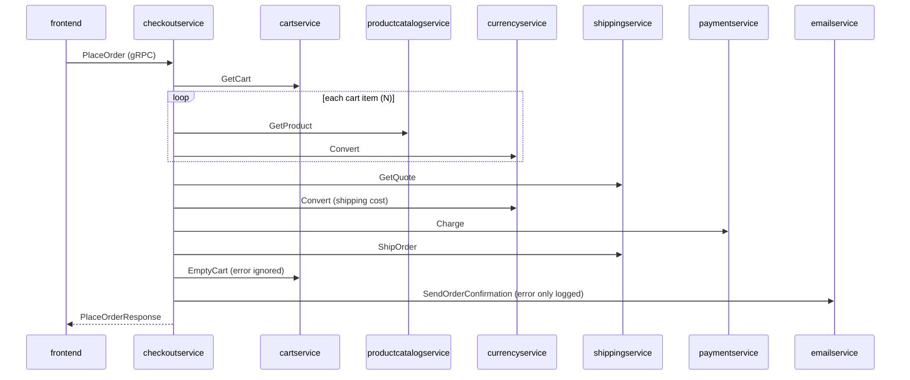

> Agent: Claude Code (VS Code extension) · Model: Claude Opus 5.5 (`claude-opus-5-5`)

# ADR-NNNN: Use synchronous gRPC with one shared `demo.proto` for inter-service communication

- **Status:** Reconstructed
- **Date:** 2026-10-26 (วันที่สร้าง ADR นี้ย้อนหลัง ส่วนวันที่ตัดสินใจจริงเป็น Not evidenced in the provided files โดย header ลิขสิทธิ์ระบุปี 2018 ใน `main.go` ทั้งสองไฟล์ และปี 2020 ใน `demo.proto`)
- **Deciders:** Not evidenced in the provided files (header ลิขสิทธิ์ระบุแค่ "Google LLC") · ADR นี้สร้างย้อนหลังโดย Claude Code

> หลักฐานที่ใช้มีเพียง `system/online-boutique/protos/demo.proto`, `system/online-boutique/src/checkoutservice/main.go`, `system/online-boutique/src/frontend/main.go` ป้าย (Cn) ในเนื้อหาอ้างถึงแถวในตาราง **Claim check** ท้ายไฟล์

## Context and problem

ข้อเท็จจริงจากโค้ด:

- สัญญา (contract) ของทุก backend service อยู่ในไฟล์เดียว `demo.proto` ภายใต้ package เดียวคือ `hipstershop` ไฟล์นี้นิยาม 9 services ได้แก่ `CartService`, `RecommendationService`, `ProductCatalogService`, `ShippingService`, `CurrencyService`, `PaymentService`, `EmailService`, `CheckoutService` และ `AdService` (C1)
- ทุก RPC เป็นแบบ unary request/response และไม่มี `stream` เลยแม้แต่ตัวเดียว (C2)
- message หลายตัวถูกใช้ร่วมกันข้าม service ได้แก่ `Money`, `CartItem`, `Address`, `Empty` และ `CreditCardInfo` (C3)
- package ไม่มีเลขเวอร์ชัน (`hipstershop` ไม่ใช่ `hipstershop.v1`) และ `PlaceOrderRequest` ข้ามหมายเลข field 4 ไปโดยไม่ประกาศ `reserved` (C4)
- `frontend` รับ HTTP จากผู้ใช้ผ่าน `gorilla/mux` แล้วเรียก backend 7 ตัวผ่าน gRPC (C5)
- `checkoutservice` ทำหน้าที่ orchestrator โดยเปิด gRPC client ไปยัง 6 services และใน `PlaceOrder` เรียกทุกตัวแบบ synchronous ทีละขั้น (C6) ถ้าตะกร้ามี N รายการ หนึ่ง order ใช้ **2N + 7** RPC (C7)
- service แต่ละตัวมี stub ที่ generate ไว้เป็นของตัวเอง (`src/checkoutservice/genproto`) (C8) และไม่ได้ใช้ code library ร่วมกัน (C9)
- gRPC ทุกเส้นมี OpenTelemetry instrumentation (`otelgrpc`) และ propagate W3C TraceContext (C10)
- ข้อยกเว้น: shopping assistant **ไม่อยู่ใน** `demo.proto` และ `frontend` ไม่ได้เปิด gRPC connection ไปหามัน ดังนั้นข้อความว่า "ทุก service สื่อสารผ่าน gRPC" ไม่จริงทั้งหมด (C11)

**ปัญหาที่ต้องตัดสินใจ:** services ควรสื่อสารกันด้วยรูปแบบใด (synchronous หรือ asynchronous) ผ่าน protocol อะไร และใครเป็นเจ้าของ contract (ไฟล์เดียวร่วมกัน หรือแยกตาม service) ทั้งนี้ไม่มีเอกสารบันทึกเหตุผลเดิมไว้ ชื่อ `microservices-demo` ใน `go_package` บอกเป็นนัยว่าระบบนี้เป็นระบบตัวอย่าง ไม่ใช่ระบบ production (C12)

## Decision drivers

ไม่มีเอกสารระบุ drivers จริง รายการต่อไปนี้จึง **[Inferred]** จากโครงสร้างโค้ดทั้งหมด เรียงจากสำคัญมากไปน้อย:

- **Simplicity / understandability**: ระบบตัวอย่างต้องอ่านเข้าใจได้ง่าย และดู API ทั้งระบบได้จากที่เดียว (C13)
- **Interoperability**: ต้องมี contract แบบ typed ที่ generate stub ให้หลายภาษาได้ (C14)
- **Performance**: request ที่ผู้ใช้รอคำตอบอยู่ต้องมี latency ต่ำ (C15)
- **Observability**: ต้อง trace ข้าม service ได้ด้วยกลไกเดียวกันทุกเส้น (C16)
- **Cost / deployability**: ไม่อยากเพิ่ม infrastructure อย่าง message broker (C17)

## Considered options

1. **A:** Synchronous gRPC (unary) + `demo.proto` ไฟล์เดียวที่ทุก service ใช้ร่วมกัน
2. **B:** Synchronous gRPC + proto แยกตาม service (แต่ละ service เป็นเจ้าของ contract ของตัวเอง และมี package ที่มีเวอร์ชัน เช่น `cart.v1`)
3. **C:** Synchronous REST/JSON over HTTP + OpenAPI spec แยกตาม service
4. **D:** Hybrid ที่ใช้ sync gRPC สำหรับ query และใช้ asynchronous messaging ผ่าน message broker (เช่น RabbitMQ หรือ Kafka) สำหรับ side effect หลังชำระเงิน (`ShipOrder`, `EmptyCart`, `SendOrderConfirmation`)

### Pros and cons of the options

| Option | Pros | Cons |
|---|---|---|
| A | ดู API ทั้งระบบได้ในไฟล์เดียว · ใช้ type ร่วมกัน (`Money`, `Address`) ทำให้ทุก service เข้าใจข้อมูลตรงกัน · stub แบบ typed ช่วยจับ mismatch ตอน compile · ไม่ต้องมี broker · `otelgrpc` และ gRPC health protocol ใช้ได้ทันที | change coupling สูง เพราะแก้ message เดียวก็กระทบ stub ของทุก service · ไม่มี versioning · temporal coupling คือ checkout จะพร้อมใช้งานได้ก็ต่อเมื่อ dependency ทั้ง 6 ตัวพร้อม · latency สะสมตามจำนวน RPC แบบลำดับ |
| B | ownership ชัดเจน · แต่ละ service พัฒนา contract ได้อิสระ · มี versioning ชัด · ยังได้ข้อดีของ gRPC ครบ | ต้องจัดการหลายไฟล์และ dependency ระหว่าง proto · type ร่วมอย่าง `Money` ต้องแยกไปไว้ใน common proto · ระบบตัวอย่างอ่านยากขึ้น · coupling ตอน runtime ยังเหมือน A |
| C | debug ง่ายด้วย curl หรือ browser · เครื่องมือแพร่หลาย · ไม่ต้อง generate code | payload เป็น JSON ซึ่งใหญ่และช้ากว่า protobuf · contract ไม่ได้ถูกบังคับตอน compile ถ้าไม่ใช้ codegen · ทุก service ต้องทำ health check และ instrumentation เอง · coupling ตอน runtime ยังเหมือน A |
| D | งานหลังชำระเงินไม่ค้างรอ email หรือ shipping · retry ได้ทนทานผ่าน queue · ลด temporal coupling ของ checkout | ต้องเพิ่ม broker ทำให้ต้นทุนและงาน ops เพิ่ม · ต้องรับมือ eventual consistency, idempotency และ ordering · ผู้ใช้ไม่ได้ tracking ID ทันทีในคำตอบ · tracing ข้าม queue ซับซ้อนกว่า |

## Decision

เลือก **Option A** (synchronous unary gRPC ร่วมกับ `demo.proto` ไฟล์เดียว) และใช้กับ backend ทุกตัวที่นิยามใน `demo.proto` แต่ไม่รวม shopping assistant (C11)

เหตุผลที่สร้างย้อนหลังได้ (**[Inferred]** เกือบทั้งหมด):

- driver อันดับแรกคือ simplicity ของระบบตัวอย่าง ไฟล์เดียวที่มี 9 services และ type ร่วมกันจึงอ่านง่ายที่สุด (C13, C18)
- flow ของผู้ใช้ทุกเส้นเป็นแบบ request/response ทั้งการแสดงหน้าเว็บและการ checkout ที่ต้องคืน `OrderResult` พร้อม tracking ID ทันที (C19) synchronous จึงตรงกับ flow นี้โดยไม่ต้องมี broker (C17)
- gRPC ทำให้ทุก service ได้ tracing (`otelgrpc`) และ health check (`grpc_health_v1`) แบบเดียวกันโดยแทบไม่ต้องเขียนโค้ดเพิ่ม (C10, C20)
- Option D ถูกตัดออก **[Inferred]** เพราะต้นทุนของ broker และ eventual consistency ไม่คุ้มสำหรับระบบตัวอย่าง ส่วน Option B ไม่คุ้มเมื่อมีทีมเดียวดูแลทั้ง repo (C21)

## Consequences

- **Positive:** contract แบบ typed ใช้ร่วมกัน ทำให้แต่ละ service เข้าใจ `Money` และ `Address` ตรงกัน (quality attribute: interoperability, correctness) (C3, C14)
- **Positive:** ไม่ต้องมี message broker จึงมี component น้อยกว่า (quality attribute: cost, deployability) (C17)
- **Positive:** ใช้ `otelgrpc` แบบเดียวกันทุกเส้น ทำให้ trace ของ checkout ทั้งเส้นเห็นได้ใน trace เดียว (quality attribute: observability) (C10)
- **Negative:** checkout ต้องเรียก dependency 6 ตัวให้สำเร็จทั้งหมด ความพร้อมใช้งานจึงประมาณเท่ากับผลคูณ availability ของแต่ละตัว (quality attribute: availability) (C6, C22)
- **Negative:** มี RPC แบบลำดับ 2N + 7 ครั้งต่อ order โดย `GetProduct` และ `Convert` ถูกเรียกใน loop ทีละรายการ latency จึงโตตามขนาดตะกร้า (quality attribute: performance) (C7)
- **Negative:** ถ้าแก้ `demo.proto` ทุก service ต้อง regenerate stub ของตัวเอง และไม่มี versioning ช่วยแยก breaking change (quality attribute: modifiability) (C4, C8, C23)
- **Negative:** ใช้ `insecure.NewCredentials()` ทำให้ traffic ระหว่าง service ไม่เข้ารหัส ทั้งที่ส่งข้อมูลบัตรเครดิต (`CreditCardInfo`) (quality attribute: security) (C24)
- **Negative:** ถ้า `ShipOrder` ล้มหลัง `Charge` สำเร็จ ระบบตอบ `codes.Unavailable` โดยไม่มี compensation (คืนเงิน) (quality attribute: reliability, data consistency) (C25)
- **Risks and mitigations:**
  - ไม่มี per-call deadline หรือ retry ใน `checkoutservice/main.go` (C26) และ `convertCurrency` ใช้ `context.TODO()` จึงไม่ส่งต่อทั้ง cancellation และ trace context ของ request (C27) → ใช้ `ctx` ของ request และตั้ง `context.WithTimeout` ทุก call **[Assumption]**
  - timeout ใน `mustConnGRPC` ไม่มีผลจริง เพราะ context ที่สร้างถูกทิ้งไป (C28) → ถ้าต้องการ fail-fast ตอน startup ให้ใช้ health check ของ dependency แทน **[Inferred]**
  - latency จาก loop → เพิ่ม batch RPC (เช่น `GetProducts`) หรือเรียกแบบขนาน (C29)
  - side effect ที่ทนความล้มเหลวได้อยู่แล้ว (`EmptyCart`, email) ใช้ async ได้ (C30) → ย้ายไปใช้ queue หรือ outbox ตาม Option D เฉพาะส่วนนี้ **[Inferred]**
  - contract evolution → ใช้ `reserved 4;`, เปลี่ยน package เป็น `hipstershop.v1` และตรวจ breaking change ใน CI (เช่น `buf breaking`) **[Assumption]**
  - security → ใช้ mTLS (เช่น ผ่าน service mesh) **[Assumption]**

## Validation

- **Load test:** วัด p95 latency ของ `PlaceOrder` เทียบกับขนาดตะกร้า N = 1, 5, 20 เพื่อยืนยันว่า latency โตเชิงเส้นตาม 2N + 7 (C7)
- **Fault injection:** ปิด `emailservice` แล้ว checkout ต้องยังสำเร็จ แต่ถ้าปิด `paymentservice` หรือ `shippingservice` checkout ต้องล้ม จากนั้นวัด error rate ของ checkout เทียบกับ availability ของ dependency (C22, C30)
- **Tracing review:** ตรวจใน trace ว่า span ของ `Convert` ต่อกับ trace ของ `PlaceOrder` หรือไม่ (C27)
- **Contract check:** รัน breaking-change check ของ `demo.proto` ทุก PR
- **Review date:** Not evidenced in the provided files ควรทบทวนเมื่อจะนำระบบไปใช้นอกบริบท demo หรือเมื่อแยกทีมเป็นเจ้าของ service

## Claim check

| # | Claim | Type | Evidence |
|---|---|---|---|
| C1 | contract ทุก backend service อยู่ใน `demo.proto` ไฟล์เดียว package `hipstershop` และมี 9 services | Evidenced | `protos/demo.proto` (`package hipstershop` บรรทัด 17; `service CartService` บรรทัด 23 … `service AdService` บรรทัด 243) |
| C2 | ทุก RPC เป็น unary และไม่มี streaming | Evidenced | `protos/demo.proto` (ทุก `rpc … returns (…)` ไม่มี keyword `stream`) |
| C3 | message ถูกใช้ร่วมข้าม service (`Money`, `CartItem`, `Address`, `Empty`, `CreditCardInfo`) | Evidenced | `protos/demo.proto` (`Money` ถูกใช้ใน `Product.price_usd`, `GetQuoteResponse`, `ChargeRequest`, `OrderItem`; `Address` ถูกใช้ใน `GetQuoteRequest`, `PlaceOrderRequest`; `CreditCardInfo` ถูกใช้ใน `ChargeRequest`, `PlaceOrderRequest`) |
| C4 | package ไม่มีเวอร์ชัน และ field 4 ของ `PlaceOrderRequest` หายไปโดยไม่มี `reserved` | Evidenced | `protos/demo.proto` (บรรทัด 17; `PlaceOrderRequest` บรรทัด 228–235 มี field 1, 2, 3, 5, 6) ส่วนเหตุผลที่ field 4 หายไปเป็น Not evidenced |
| C5 | `frontend` รับ HTTP และเรียก backend 7 ตัวผ่าน gRPC | Evidenced | `src/frontend/main.go` (`mux.NewRouter` บรรทัด 149, `http.ListenAndServe` บรรทัด 171, `mustConnGRPC` × 7 บรรทัด 141–147) |
| C6 | `checkoutservice` เปิด gRPC ไป 6 services และเรียกแบบ synchronous ทีละขั้นใน `PlaceOrder` | Evidenced | `src/checkoutservice/main.go` (`type checkoutService` บรรทัด 66–86, `mustConnGRPC` บรรทัด 118–123, `PlaceOrder` บรรทัด 230–280) |
| C7 | หนึ่ง order ใช้ 2N + 7 RPC แบบลำดับ | Evidenced | `src/checkoutservice/main.go` (`prepOrderItems` loop บรรทัด 343–355 เรียก `GetProduct` + `convertCurrency` ต่อรายการ บวกกับ `getUserCart`, `quoteShipping`, `convertCurrency`, `chargeCard`, `shipOrder`, `emptyUserCart`, `sendOrderConfirmation`) |
| C8 | แต่ละ service มี generated stub ของตัวเอง | Evidenced (เฉพาะ checkout) | `src/checkoutservice/main.go` (import `…/src/checkoutservice/genproto` บรรทัด 34) ส่วนของ service อื่นเป็น Inferred |
| C9 | services ไม่ได้ใช้ code library ร่วมกัน | Evidenced | TODO "duplicated in other microservices using Go since they are not sharing packages" ใน `src/checkoutservice/main.go` บรรทัด 181–182 และ `src/frontend/main.go` บรรทัด 195–196 |
| C10 | gRPC ทุกเส้นมี `otelgrpc` และใช้ W3C TraceContext | Evidenced | `src/checkoutservice/main.go` (`otelgrpc.NewServerHandler` บรรทัด 139, `NewClientHandler` บรรทัด 216, `propagation.TraceContext` บรรทัด 135–137); `src/frontend/main.go` (บรรทัด 107–109, 231) |
| C11 | shopping assistant ไม่อยู่ใน `demo.proto` และไม่มี gRPC connection จาก frontend | Evidenced | `src/frontend/main.go` (`shoppingAssistantSvcAddr` บรรทัด 88, 139 ไม่มี `…Conn` และไม่มี `mustConnGRPC`); `protos/demo.proto` ไม่มี service นี้ ส่วน protocol ที่ใช้จริงเป็น Not evidenced |
| C12 | ระบบนี้เป็นระบบตัวอย่าง (demo) | Inferred | ชื่อ `go_package = "github.com/GoogleCloudPlatform/microservices-demo/…"` ใน `protos/demo.proto` บรรทัด 19 และชื่อไฟล์ `demo.proto` |
| C13 | driver อันดับแรกคือ simplicity และการดู API ได้จากที่เดียว | Inferred | ไม่มีเอกสารเหตุผล อนุมานจากการรวมทุก service ไว้ในไฟล์เดียว |
| C14 | ต้องการ contract แบบ typed ที่รองรับหลายภาษา | Inferred | ภาษาของ service อื่นนอกจาก Go เป็น Not evidenced in the provided files |
| C15 | ต้องการ latency ต่ำสำหรับ request ที่ผู้ใช้รอ | Assumption | ความรู้ทั่วไปว่า gRPC/protobuf มี overhead ต่ำกว่า JSON over HTTP/1.1 |
| C16 | ต้องการ observability แบบเดียวกันทุกเส้น | Inferred | อนุมานจาก C10 ที่ instrument เหมือนกันทุกเส้น แต่ไม่มีเอกสารว่าเป็น driver |
| C17 | ไม่มี message broker ในการสื่อสารที่เห็น | Evidenced | ไม่มี import ของ broker client ใน `src/checkoutservice/main.go` และ `src/frontend/main.go` ส่วนเหตุผลว่า "เพื่อลดต้นทุน" เป็น Inferred |
| C18 | ไฟล์เดียวอ่านง่ายที่สุดสำหรับระบบตัวอย่าง | Inferred | ไม่มีหลักฐานตรง |
| C19 | checkout ต้องคืน `OrderResult` พร้อม tracking ID ทันที | Evidenced | `protos/demo.proto` (`PlaceOrderResponse.order`, `OrderResult.shipping_tracking_id`); `src/checkoutservice/main.go` บรรทัด 258–279 |
| C20 | ใช้ gRPC health protocol | Evidenced | `src/checkoutservice/main.go` (`healthpb.RegisterHealthServer` บรรทัด 143–144; `Watch` คืน `Unimplemented` บรรทัด 226–228) ส่วน frontend ใช้ HTTP `/_healthz` (`src/frontend/main.go` บรรทัด 161) |
| C21 | Option B และ D ถูกตัดออกเพราะต้นทุนไม่คุ้มสำหรับระบบตัวอย่างที่มีทีมเดียว | Inferred | ไม่มีหลักฐานว่าเคยพิจารณา option เหล่านี้ และจำนวนทีมเป็น Not evidenced |
| C22 | availability ของ checkout ≈ ผลคูณ availability ของ dependency ที่จำเป็น | Assumption | หลักทั่วไปของ synchronous call chain แต่โครงสร้างที่ทำให้หลักนี้ใช้ได้มีหลักฐานใน C6 |
| C23 | การแก้ proto กระทบทุก service ที่ใช้ร่วมกัน | Inferred | อนุมานจาก C1, C3, C8 แต่ไม่มีหลักฐานเรื่อง build pipeline |
| C24 | traffic ระหว่าง service ไม่เข้ารหัส และมีข้อมูลบัตรเครดิตวิ่งผ่าน | Evidenced | `insecure.NewCredentials()` ใน `src/checkoutservice/main.go` บรรทัด 215 และ `src/frontend/main.go` บรรทัด 230; `CreditCardInfo` ใน `protos/demo.proto` บรรทัด 181–186 ส่วนการเข้ารหัสระดับ infrastructure (เช่น mesh) เป็น Not evidenced |
| C25 | ไม่มี compensation เมื่อ shipping ล้มหลังตัดเงินแล้ว | Evidenced | `src/checkoutservice/main.go` (`chargeCard` บรรทัด 252 ถูกเรียกก่อน `shipOrder` บรรทัด 258–261 ซึ่งคืน `codes.Unavailable` และไม่มีการเรียก refund) |
| C26 | ไม่มี per-call deadline หรือ retry | Evidenced | ไม่มี `context.WithTimeout` รอบ RPC และไม่มี retry option ใน `grpc.NewClient` (`src/checkoutservice/main.go` บรรทัด 214–216, 313–394) ส่วน deadline ที่อาจมาจาก caller เป็น Not evidenced |
| C27 | `convertCurrency` ไม่ส่งต่อ context ของ request | Evidenced | `src/checkoutservice/main.go` บรรทัด 360 (`Convert(context.TODO(), …)`) ส่วนผลที่ทำให้ span หลุดจาก trace เป็น Inferred |
| C28 | timeout ใน `mustConnGRPC` ไม่มีผล | Evidenced | `src/checkoutservice/main.go` บรรทัด 212 (`_, cancel := context.WithTimeout(...)` ทิ้ง context ไป) ส่วนที่ว่า `grpc.NewClient` ไม่ dial ทันทีเป็น Assumption |
| C29 | batch RPC หรือการเรียกแบบขนานช่วยลด latency ได้ | Assumption | แนวปฏิบัติทั่วไป ใน `demo.proto` ไม่มี batch `GetProducts` |
| C30 | `EmptyCart` และ email ทนความล้มเหลวได้อยู่แล้ว | Evidenced | `src/checkoutservice/main.go` บรรทัด 263 (`_ = cs.emptyUserCart`) และบรรทัด 273–277 (email error แค่ `log.Warnf`) |
